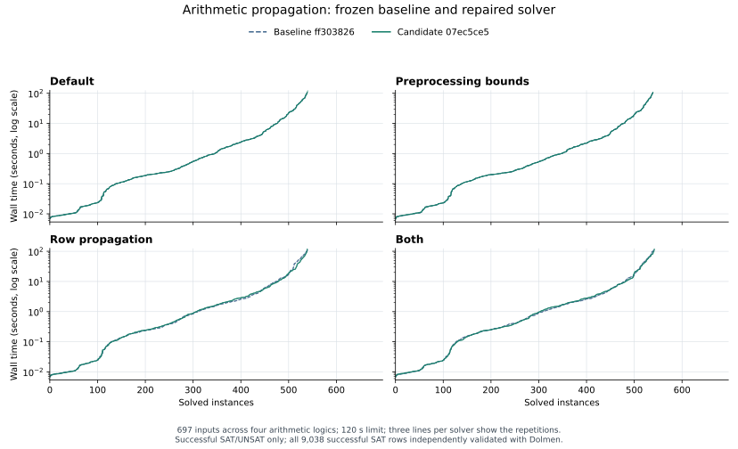

# Bound propagation repairs and performance

The notification and integer-rounding repairs and scan-local endpoint cache are implemented and correctness-qualified. The broad performance result is mixed: row mode loses a median solved instance, combined mode keeps the same median solved count, and aggregate PAR2 changes are small. These results do not justify promoting either row mode to default. The later preprocessing-placement trial was rejected and reverted.

## Scope and measurement

The comparison uses frozen Primo source `ff303826` (its source-equivalent compiled snapshot is `a4b5d75f`) and candidate `07ec5ce5`. It runs the same 697 selected inputs: 200 QF_LIA, 300 QF_UFLIA, 100 QF_LRA and 97 QF_UFLRA. Three predeclared QF_UFLRA abort quarantines from the original 700-input selection remain excluded, not counted as passes. No new cases were removed.

There are 16,728 native timings: four profiles, two binaries and three repetitions. Each allocation requests one SLURM CPU and 10 GiB, with a 120-second native deadline and an 8 GiB address-space limit. Each baseline/candidate pair stays adjacent; profile order and pair order rotate. The three whole timing arrays run sequentially. Five compute hosts were used; observed affinity masks contain two logical CPU IDs. CPU model, physical-core mapping and isolation were not established. Every one of the 9,038 successful SAT timing rows subsequently passed its own exact-option native model replay and direct Dolmen check. Validation time is excluded from timings. Z3 supplies correctness references in the separate gates; this is not a fresh reference-solver speed comparison.

All profiles enable the existing same-variable arithmetic propagation. `pre` adds preprocessing bound tightening; `rows` adds forward and reverse row propagation; `both` adds both. Integer branching stays private, with the existing limits, equality settings and UF fallback policy. Own-row notifications and the cache serve all four arithmetic routes. Derived integer endpoint rounding follows the existing `All` policy: enabled by default in QF_LIA, while non-strict rounding remains opt-in in QF_UFLIA. Full provenance, input hashes and job dependencies are retained in the protocol and comparison artifacts linked below.

## Aggregate result

The table reports the median of the three solved counts and the median of the three mean PAR2 scores. A successful SAT/UNSAT run contributes its measured time to PAR2; every other outcome contributes 240 seconds. Paired solved deltas retain the separate repetitions, candidate minus baseline.

| Profile | Median solved, baseline → candidate | Mean PAR2 seconds, baseline → candidate | Paired solved deltas |
| --- | ---: | ---: | --- |
| `default` | 539 → 539 | 58.392 → 58.348 | 1, 0, 0 |
| `pre` | 539 → 539 | 58.158 → 58.160 | 0, 0, 0 |
| `rows` | 540 → 539 | 58.553 → 58.313 | -1, -1, -2 |
| `both` | 542 → 542 | 57.797 → 57.596 | -1, 0, 0 |

The row and combined PAR2 reductions are about 0.41% and 0.35%. They coexist with stable gains and losses and a deadline-sensitive outcome in the unchanged control: in repetition zero, default-profile slot 557 times out at 120.317 s on the baseline and finishes at 119.802 s on the candidate. The default and preprocessing-only profiles have identical recorded search counters on their common successful cases in the first repetition. Aggregate differences of this size should not be presented as a general solver speedup.

On the conditional cohort solved by both binaries in all three repetitions, with baseline median time at least one second, the geometric means of per-case paired median time ratios are 0.893 for `rows` and 0.911 for `both` (candidate/baseline). These exclude gained and lost instances and therefore do not override the whole-selection result.

Each curve is one repetition. Cactus ranks can correspond to different instances; the paired analysis and outcome counts provide the case-level comparison. {download}`Download the figure as PDF <../_static/bound-repairs-cactus.pdf>`. The optional figure generator uses Matplotlib 3.11.2; its provenance file records input and generator hashes.

## Breakdown by logic

These are again medians across repetitions; per-logic medians need not sum to the aggregate median.

| Logic (inputs) | Profile | Solved, baseline → candidate | Mean PAR2 seconds, baseline → candidate |
| --- | --- | ---: | ---: |
| QF_LIA (200) | `default` | 104 → 104 | 120.708 → 120.673 |
| QF_LIA (200) | `pre` | 104 → 104 | 120.008 → 119.998 |
| QF_LIA (200) | `rows` | 104 → 102 | 120.486 → 121.203 |
| QF_LIA (200) | `both` | 104 → 102 | 119.888 → 121.560 |
| QF_UFLIA (300) | `default` | 259 → 259 | 35.351 → 35.351 |
| QF_UFLIA (300) | `pre` | 257 → 257 | 36.735 → 36.734 |
| QF_UFLIA (300) | `rows` | 259 → 260 | 35.799 → 35.191 |
| QF_UFLIA (300) | `both` | 259 → 260 | 35.796 → 35.118 |
| QF_LRA (100) | `default` | 85 → 85 | 41.151 → 41.063 |
| QF_LRA (100) | `pre` | 87 → 87 | 36.819 → 36.810 |
| QF_LRA (100) | `rows` | 86 → 86 | 41.459 → 40.436 |
| QF_LRA (100) | `both` | 88 → 89 | 37.330 → 34.887 |
| QF_UFLRA (97) | `default` | 91 → 91 | 18.888 → 18.891 |
| QF_UFLRA (97) | `pre` | 91 → 91 | 18.884 → 18.882 |
| QF_UFLRA (97) | `rows` | 91 → 91 | 18.857 → 18.602 |
| QF_UFLRA (97) | `both` | 91 → 91 | 18.835 → 18.585 |

The largest native RSS remains about 7.41 GiB for both binaries. The retained comparison reports per-repetition median/max RSS, missing-statistics outcomes, family summaries and available mechanism counters. The five new counters are unavailable on the frozen baseline; unavailable work is represented as null rather than zero.

## Gains, regressions and the cache control

An instance is a stable gain/loss here only if its outcome changes in the same direction in all three repetitions. Row mode gains slots 254 and 255 and loses 2, 17, 213 and 597. Combined mode also gains 569 and has the same four stable losses. Other cutoff-sensitive outcomes explain why median solved counts do not equal this stable-case balance. The selection and full file paths are retained in the artifacts; slot numbers are indices in the 697-input selection.

All four stable losses, the largest consistent time ratio among common cases (slot 64), and the predeclared Wisa cache case (438) received three further paired repetitions, with 120-second native limits and separate SAT-model validation. The follow-ups contain 72 timings and 30 successful SAT rows, all direct Dolmen passes. Another 60 diagnostic prefixes stop at 1, 10 or 100 reported theory conflicts, or 15 seconds: 58 return unknown and two time out. Those prefixes are diagnostic resource outcomes, not completed speed runs.

| Observation | Evidence and limit |
| --- | --- |
| Wisa cache probe, slot 438 | Against the notification/rounding repair alone (`3c2971a4`), row time falls from 3.716–3.760 s to 2.770–2.810 s. Combined time falls from 0.498–0.510 s to 0.460–0.467 s. All three pairs retain exactly 13,007 and 3,752 pivots respectively. This isolates a repeatable cache benefit on this input; it is not a whole-corpus percentage. |
| Cache work on that probe | Row mode makes 2,858,721 direction-calculation attempts for 10,326,934 candidate comparisons; combined mode makes 416,447 for 1,493,495. Missing endpoints are cached too. These are work counters, not delivered facts or a direct CPU-time attribution. |
| Slots 2 and 17, QF_LIA | Baseline row runs finish in about 91–92 s in the first formal repetition, while candidate runs time out. Candidate timeout statistics record about 33–38 million own-basic-row scan requests, counted before the row-size guard. This identifies a high notification rate, not useful arithmetic work or a measured CPU share. The 100-conflict prefixes are still close in time, so they do not by themselves explain the late search or measure its CPU breakdown. |
| Slot 213, Certora QF_UFLIA | Both baseline row profiles finish near 56–57 s in the first repetition; candidate profiles time out. At 100 conflicts, row-mode decisions change from 720 to 841 and combined decisions from 719 to 895. The trace has changed early; the full candidate timeouts lack statistics, so no deeper phase attribution is claimed. |
| Slot 597, QF_LRA | Baseline proves UNSAT near 98 s. At timeout, candidate row mode has 170,236 pivots and 455,364 delivered row propagations, versus the completed baseline’s 155,910 and 329,049. These are different stopping points, showing extra work rather than equal-work throughput. |
| Slot 64, QF_LIA | Baseline proves UNSAT near 0.232 s; candidate takes about 39 s. Private nodes grow from 45 to 2,118 despite similar persistent-tableau pivots and SAT decisions. With a 100-conflict prefix, baseline stops near 0.22 s while candidate hits the 15-second deadline. This exposes a private-search regression, not just row-scan overhead. |

More valid propagation can change SAT activity, the rational candidate and subsequent integer search. It can also add callback work. The implementation retains the repairs within the existing opt-in row modes and retains the cache’s demonstrated local benefit. It makes no default promotion and does not claim that additional propagation consistently improves solving. Filtering redundant notifications and stronger cross-event refinement remain separate work.

## Correctness and implementation limits

The exact candidate passed 49 native test groups and 354 Python tests. Fresh generated gates record 9,980 reference matches, 18 timeouts, one diagnosed private-budget unknown reproduced on the baseline and one reference timeout; all 7,069 selected SAT models pass direct Dolmen. The canonical 2,400-case gate has 1,345 model passes. Real-seed mutations record 2,508 matches and 12 resource-incomplete cases out of 2,520, with 1,680 SAT-model passes and no saved failures. Resource replays preserve incomplete outcomes. The 57 tracked regression inputs per row profile preserve query sequences and validate 27 single-query and six incremental SAT models per profile.

ASan’s 49 tests and both 140-translation-unit static scans reuse the explicitly checked identical C++ source from `1d3bee8c`; native revision metadata and later scripts/docs differ. Static findings remain inventoried: 861 tidy findings, including 397 include-provider findings, with no unused-header blockers. This is not a clean-tree claim. The code, ownership, reason lifetimes, caps and conditional integer rounding are described in the [implementation checklist](../leads/bound-propagation-improvements.md).

This is bounded interval refinement against existing atoms, based on Dutertre and de Moura, CAV 2006 §§4.5 and 5. It does not install full numeric closure or rescan every pivot. The cache is an engineering optimization within a synchronous scan; explanation copies and quadratic reverse-row work remain. No private branch budget, UF fallback or termination claim changes.

## Reproducibility

Primary timing arrays: `392428`, `392429`, `392430`; model arrays: `392573`, `392574`, `392577`. Follow-up timing/model arrays: `396630`, `396631`; conflict-prefix array: `396637`. All solver execution and qualification builds ran in SLURM. SSH routes and corpus roots stay outside tracked files.

The retained {boundrepaircomparison}`protocol <benchmarks/bound-repairs-20261114/final-protocol.json>`,
{boundrepaircomparison}`full comparison <benchmarks/bound-repairs-20261114/final-comparison/comparison.json>`,
{boundrepaircomparison}`timing CSV <benchmarks/bound-repairs-20261114/final-comparison/measurements.csv>` and
{boundrepaircomparison}`follow-up receipts <benchmarks/bound-repairs-20261114/followups.json>`
include every native row, model/receipt hashes, family summaries, memory and counter availability.
The {boundrepairfinalevidence}`exact-source qualification <benchmarks/bound-repairs-20261114/final-qualification.json>`
retains correctness-gate commands, counts and tool identities. The
{boundrepaircomparison}`analysis controller <scripts/qualification/bound_repairs/analyze.py>` and
{boundrepaircomparison}`follow-up auditor <scripts/qualification/bound_repairs/analyze_followups.py>`
check input/config identities, order, process outcomes and exact-option model coverage.
The {boundrepaircomparison}`optional figure generator <scripts/qualification/bound_repairs/plot.py>`
requires Matplotlib; {boundrepaircomparison}`figure provenance <docs/_static/bound-repairs-cactus.json>`
records its version and all input hashes.
