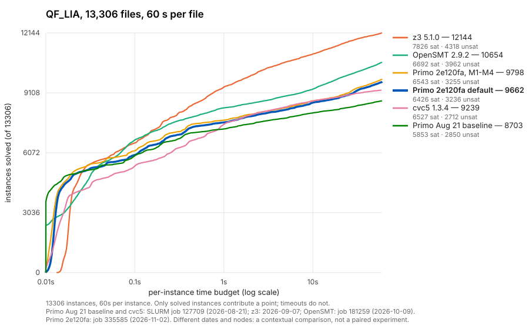

# QF_LIA progress against reference solvers

**Status: contextual comparison, 2026-11-03.** All series cover the same
13,306 QF_LIA files at 60 s per file, but they come from runs on different
dates and nodes, so this is not a paired experiment.



In the figure legend, M1-M4 means all four integrality options, milestones M1
to M4 of the {ref}`integrality evaluation <integrality-evaluation>`.

| Series | Run | Solved | PAR2 (s) |
|---|---|---|---|
| z3 5.1.0 | 2026-09-07 | 12,144 | 174,586 |
| OpenSMT 2.9.2 | job 181259, 2026-10-09 | 10,654 | 361,027 |
| Primo `2e120fa`, all four integrality options | job 335585, 2026-11-02 | 9,798 | 459,979 |
| Primo `5efbd02` | 2026-10-05 | 9,705 | 470,785 |
| Primo `2e120fa`, default | job 335585 | 9,662 | 474,705 |
| cvc5 1.3.4 | job 127709, 2026-08-21 | 9,239 | 507,295 |
| Primo August baseline (before conflict generalization) | job 127709 | 8,703 | 574,137 |

A file counts as solved when the run exits normally with `sat` or `unsat`
within 60 s; PAR2 counts each unsolved file as 120 s. A clean `unknown` exit
counts as unsolved. Primo gives one, for example, when branch-and-bound
reaches its node limit: 569 files in the August run, 751 for the current
default and 450 with the options. OpenSMT ends in an error on 21 files. Every
series reports zero wrong answers against the declared statuses. The run-log
entry `2026-08-21-qf-lia-conflict-generalization` records the August run as
8,704 solved, one more than this counting rule gives. The figure omits the
`5efbd02` series to keep each curve a distinct colour.

## What the comparison shows

- **The default has improved a lot since August.** Primo solves 1,023 files
  that the August baseline did not and loses 64, a net of +959. PAR2 fell
  from 574,137 to 474,705 s. Most of the gain is `nec-smt`, from 608 to 1,236
  solved. Bromberger (+105), `convert` (+60), `slacks` (+55) and CAV 2009
  (+47) follow. The gap to z3 went from 3,441 to 2,482 files, and to OpenSMT
  from 1,951 to 992. Primo went from 536 files behind cvc5 to 423 ahead.
- **The integrality options add to that on QF_LIA.** In the first run, all
  four options solve 9,798, 136 more than the default in the same job: they
  gain 411 files and lose 275. The family churn is large in both directions,
  for example CAV 2009 +117/−59 and Bromberger +66/−79. Net gains come
  mostly from `nec-smt` (+83), CAV 2009 (+58), `dillig` (+38) and `rings`
  (+31). Net losses come from `slacks` and `prime-cone` (−17 each),
  `cut_lemmas` (−14) and Bromberger (−13).
- **Part of that gain does not reproduce.** In the 2026-11-03 rerun (job
  339382) the default solves 9,662 again (+5 −5), but the options solve
  9,745. Of the 60 files the options arm lost relative to its first run, 57
  are `nec-smt`. Counting only files that behave the same in both runs, the
  options gain 348 and lose 274, an estimated stable net of +74. On QF_UFLIA
  the same options lose 31 files ([QF_UFLIA progress](qf-uflia-progress.md)),
  so they are not the default.
- **The default trails the October run by 43 files.** Against `5efbd02` it
  gains 3 and loses 46. Of those losses, 41 also stay unsolved in the rerun,
  38 of them `nec-smt`. Outside `nec-smt` no family moves by more than two
  files. The 46 lost files had all solved in 52.5 to 59.9 s in October; 46
  of the 222 files October solved in 45 to 60 s are lost. The current default
  is also slightly slower in this comparison: on the 2,228 files both runs solve
  whose October time is at least 0.5 s, it takes a median 2.3% longer
  (quartiles 0.996 and 1.061 times October's time). A slowdown of at most
  6.1% would push 31 of the 46 past 60 s; the other 15 need more, so they
  slowed by more than the upper-quartile ratio. The data does not separate a
  code slowdown from a node or date difference. A paired pilot on another
  host found no code slowdown large enough to explain the gap (see below); a
  paired run on the cluster nodes would confirm it.
- **Remaining gap.** Against z3 the default is furthest behind on `nec-smt`
  (994 files), Bromberger (398), `rings` (255), CAV 2009 (239),
  `rings_preprocessed` (185), `convert` (139) and `slacks` (116).

## Paired pilot on a quiet host (2026-11-03)

The run-log entry `2026-11-03-calm-host-timing-pilot` records a small paired
run of both binaries, `5efbd02` and `2e120fa`, on the research host dai-03.
This host is outside SLURM, an AMD EPYC 7513 with frequency boost on, and
was idle at the start. Each run was pinned to its own physical core. The
subset was 292 files:

- 100 easy files both cluster runs solved in under 50 ms;
- 100 files solved in 1 to 45 s;
- the 46 files lost since October;
- 46 files both runs solved in 45 to 60 s.

**Startup.** Serially, on one core, each binary ran `--version` 50 times and
each easy file 5 times. The medians were 3.28 ms (`5efbd02`) and 3.35 ms
(`2e120fa`) for `--version`, and 4.51 and 4.68 ms for the easy files.
Repeated runs of one file varied by a median 1.2%. So the current binary is
about 4% slower on easy files, about 0.17 ms. On the cluster, the medians on
easy files were 8.2 ms (October) and 12.6 ms (November). That 4 ms gap is not
a property of the binaries.

**Solving.** Each (file, binary) pair ran three times, in shuffled order, on
16 cores. Another user's jobs started about 13 minutes in and oversubscribed
the host. Runs that started after that took a median 1.53 times as long as
the same file and binary before it, and up to 2.27 times. Only the 915 runs
that finished before that point are used below.

- **Repeatable.** Of the files with at least two clean runs per binary (157
  for `5efbd02`, 156 for `2e120fa`), none was solved in some runs and not
  others. For files taking at least 0.5 s, repeated times differed by a
  median 3% and at most 20%.
- **About 1% slower, mostly on short runs.** On the 229 files both binaries
  solved in all their clean runs, `2e120fa` took a median 1.006 times as long
  as `5efbd02` on this host (quartiles 0.979 and 1.043). By group: easy 1.022
  (83 files), 1 to 45 s 1.010 (77), near-cutoff 1.005 (37), and the files
  lost since October 0.996 (32).
- **Cutoff effects cannot be tested here.** This host ran the 1 to 45 s files
  in a median 0.6 times their cluster time. Files near the cluster's 60 s
  cutoff therefore finish well inside it here, and every clean run of the
  lost and near-cutoff files was solved by both binaries. Across all runs,
  including contaminated ones, each binary solved 45 of the 46 lost files at
  least once. The evidence on those files is the paired time ratio above, not
  the solved count.

This is a pilot, not an evaluation. It uses one host that is not a cluster
node and a subset of 292 files, and 837 of its 1,752 runs were discarded
for load. Its runner script is kept with the results on the host and is not
committed. It finds no code slowdown that would explain the 43-file October
gap, which is consistent with a node or date cause. It does not test the
cluster nodes.

## Reproduction

The cactus plot is drawn by {source}`plot_cactus.py <scripts/plot_cactus.py>`:

```bash
python3 scripts/plot_cactus.py --timeout 60 --sort-by-solved \
  --title "QF_LIA, 13,306 files, 60 s per file" \
  --highlight-series "Primo 2e120fa default" \
  --series "z3 5.1.0=<hist>/z3" --series "cvc5 1.3.4=<hist>/cvc5" \
  --series "OpenSMT 2.9.2=<hist>/opensmt" \
  --series "Primo Aug 21 baseline=<127709>/primo" \
  --series "Primo 2e120fa default=<ab>/QF_LIA/off" \
  --series "Primo 2e120fa, M1-M4=<ab>/QF_LIA/all" \
  --note "Primo Aug 21 baseline and cvc5: SLURM job 127709 (2026-08-21); z3: 2026-09-07; OpenSMT: job 181259 (2026-10-09)." \
  --note "Primo 2e120fa: job 335585 (2026-11-02). Different dates and nodes: a contextual comparison, not a paired experiment." \
  --out docs/_static/qf-lia-cactus.svg
```

In the cluster workspace `primo-cadical-profile`, `<hist>` is
`results/qf-lia-opensmt-20261009/historical` (its `primo` arm is `5efbd02`)
and `<127709>` is `results/qf-lia-full-compare-127709`. `<ab>` is
`results/m5-ab-2e120fa` in `primo-lia-integrality`. The run-log entries
`2026-10-09-recovered-qf-lia-comparison-5efbd02`,
`2026-10-09-qf-lia-opensmt-full-division` and
`2026-11-02-lia-integrality-ab-2e120fa` hold the provenance. The rerun is
`results/m5-noise-2e120fa` in `primo-lia-integrality`, run-log entry
`2026-11-03-lia-integrality-noise-rerun-2e120fa`.
