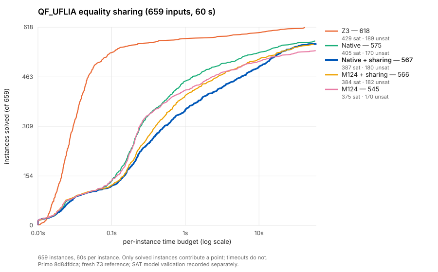
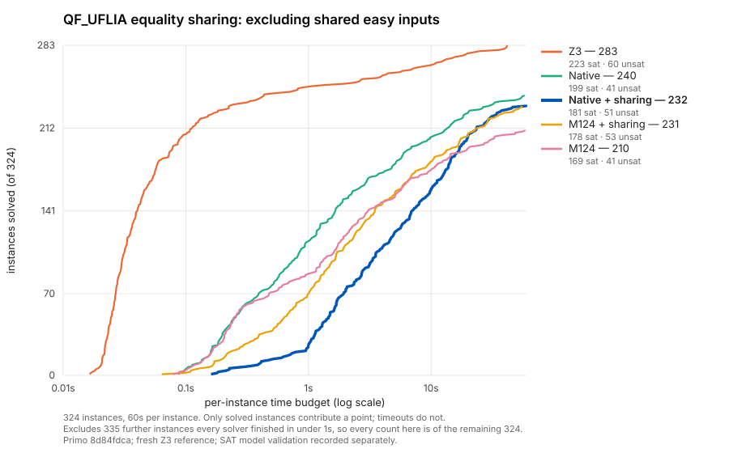

# QF_UFLIA equality sharing: larger comparison and profiles

**The full comparison, profiles and selected option diagnostics are complete.**

The original 44-case, 15-second development selection was weighted toward
historical M124 regressions. It exposed a real problem, but missed important
benefits elsewhere. On all 659 available inputs at 60 seconds, equality sharing
loses eight net solves with native settings and gains 21 with M124. The
integration remains experimental and default off.

## Scope and controls

The {download}`machine-readable record <../../benchmarks/qf-uflia-tableau-equalities-full60-20261107.json>`
contains input hashes, binaries, outcomes, family summaries and reproduction
metadata. Raw artifacts live under `results/uflia-equality-full60-20261107/`;
the canonical entries are in {download}`the run ledger <../run-log.json>`.
This is the complete available four-family corpus, not every QF_UFLIA benchmark.

The measured candidate is `8d84fdca`, with runtime API source at `6e46d0dd`;
the frozen previous binary is `1b2cc307`. Both use Release builds and the same
CaDiCaL revision. All six profiles run serially for each input, in rotated
order within one SLURM allocation: old, current disabled, and current enabled,
under both native and M124 settings. The 48 shards initially used a throttle
of 24, raised to 48 after observing idle compute capacity. Each task requests
one CPU and 8 GiB; SLURM grants two logical CPUs. No solver source or default
changed during this investigation.

M124 enables bound rounding, primitive integer rows and integral patch moves,
with integer slacks disabled. Native explicitly disables those three options
and integer slacks. Arithmetic model phase is off in all full-corpus arms.
Sharing is enabled only by `--qf-uflia-tableau-equalities`.

The current disabled profiles reproduce the old solved sets, 575 native and
545 M124. Every non-time counter matches on those commonly solved inputs.
Timeout prefixes are not required to match. The small runtime differences
between old and current disabled binaries are not a speedup claim.

## Full results

PAR2 below is the sum of successful runtimes plus 120 seconds for each unsolved
input. Only zero-exit `sat` or `unsat` answers count as solved; no errors,
unsupported inputs, clean `unknown`s or wrong answers occurred in these runs.

| Current profile | Solved /659 | SAT | UNSAT | Timeouts | PAR2 sum (s) |
| --- | ---: | ---: | ---: | ---: | ---: |
| Native, sharing off | 575 | 405 | 170 | 84 | 11,362.23 |
| Native, sharing on | 567 | 387 | 180 | 92 | 13,173.51 |
| M124, sharing off | 545 | 375 | 170 | 114 | 14,882.47 |
| M124, sharing on | 566 | 384 | 182 | 93 | 12,844.92 |
| Fresh Z3 reference | 618 | 429 | 189 | 41 | 5,429.85 |

Sharing gains 17 cases and loses 25 under native settings, increasing PAR2 by
15.9%. Under M124 it gains 27 and loses six, reducing PAR2 by 13.7%.
These gains coexist with latency costs: on common solved cases where at least
one arm takes 50 ms, the enabled/disabled geometric mean is 2.03 native
(447 cases) and 1.31 M124 (435 cases); medians are 1.16 and 1.11.
This does not establish a uniformly better profile.

The family breakdown explains why the development selection was misleading:

| Family | Inputs | Native off | Native on | M124 off | M124 on |
| --- | ---: | ---: | ---: | ---: | ---: |
| Certora | 76 | 6 | 7 | 6 | 8 |
| TwoSquares | 21 | 21 | 21 | 21 | 21 |
| MathSAT | 454 | 441 | 454 | 441 | 454 |
| Wisas | 108 | 107 | 85 | 77 | 83 |

The Certora row abbreviates `20230314-Jaroslav-Bendik-Certora`. Sharing closes
all 13 remaining MathSAT cases in this corpus. Wisas is still a substantial
native regression, even with four times the earlier timeout.

The second view removes exactly 335 inputs that every displayed profile,
including Z3, solves in under one second. Its counts refer to the remaining
324 inputs; the full metrics above remain unchanged.

## Independent correctness stage

All 3,373 successful Primo timing rows match fresh Z3 answers. Every one of the
2,331 successful SAT rows then passes separate direct Dolmen replay, using the
same binary and ordered solver arguments, with model production added. Model
replay starts after every timing shard finishes; its time is excluded from
runtimes and PAR2. The replay uses 60-second solver and 30-second Dolmen limits.
There are no invalid models, changed answers, missing rows or validator
failures. This checks SAT models independently; it is not an UNSAT proof.

The exact runtime snapshot also has the previously recorded generated and
mutation qualification described in the
[integration page](../implementation/uflia-equality-propagation.md#counters-and-current-qualification).
That older qualification is distinguished from these fresh corpus checks.

## Three different effects

### A Wisas regression has much higher pivot work

On `wisas/xs_37_57.smt2`, native off solves in 1.62 seconds; enabled times out
at 60 seconds. The following enabled counters describe its partial trace,
compared with the completed disabled trace:

| Observation | Off | On, partial at timeout |
| --- | ---: | ---: |
| Reported LRA pivots | 12,704 | 221,470 |
| Rows rewritten by pivots | 22,336 | 4,134,895 |
| Terms merged during row rewriting | 762,513 | 222,166,073 |
| Rows rewritten per reported pivot | 1.76 | 18.67 |
| Terms merged per reported pivot | 60.02 | 1,003.14 |
| Registered interface pairs | 124 | 290 |
| Arithmetic atoms | 1,385 | 1,641 |

The counter definitions are in
{ufliaeqsource}`LraTableau::pivot <src/theory/arithmetic/lra_tableau.cpp>`:
row updates count affected rows, and term operations count terms merged from
the two rows. Fixed-variable elimination is off here, with zero elimination
pivots. These are different search traces, so the ratios do not isolate a
causal effect on identical pivot states. They do show much more work per
reported pivot, predominantly a larger affected-row count.

Equality scanning takes only 11.6 ms. Component growth takes about 22 ms,
versus 91 ms disabled, with fewer growth rounds (26 versus 124). Integer
completion takes only 2.5 ms in the enabled partial trace. Neither direct scan
time nor the measured direct growth time explains a minute of runtime.
The outer SAT timer includes online theory callbacks; it is not pure Boolean
solving time. All 120 enabled native stack observations are inside SAT and its
callbacks; 32 contain `LraTableau::pivot` and 30 contain
`LiaTheoryComponent::assign` under the summary's exclusive operation buckets.

### The Certora regression enters hard integer completion

The selected Certora file ending `39657_2866defdd1f2434b69ab_47_QF_UFLIA.smt2`
solves in 26.48 seconds disabled and times out at 60 seconds enabled. Native
sampling finds integer completion in 110 of 120 enabled stacks, including
`branch_and_bound`, tableau checks and rational arithmetic. The GNU Multiple Precision Arithmetic Library (GMP) appears in
53 stacks. The disabled run supplies 49 observations, only one in integer
completion. These cover different durations and search states; they are wall
time observations, not CPU percentages or measurements of coefficient bit size.

The owning operations are
{ufliaeqsource}`LiaComponentAdapter::check <src/smt/solver_engines.cpp>` and
{ufliaeqsource}`integer completion <src/theory/arithmetic/lia_completion.cpp>`.
This is a different bottleneck from the Wisas online SAT/callback trace.

### MathSAT avoids an expensive arrangement fallback

On `mathsat/EufLaArithmetic/medium/medium13.smt2`, disabled runs exhaust the
512 model-equality decision budget, materialize all 30,135 interface pairs,
and time out. Sharing proves UNSAT in about one second with 766 registered
pairs: 704 proved equalities and 62 model choices. Of the proved equalities,
700 come from `FixedEq`, three from `EqRow`, and one from `EqRows`.
No complete-arrangement fallback occurs.

The budget transition is owned by
{ufliaeqsource}`solve_component_recipe <src/smt/component_solver.cpp>`.
Here adding proofs reduces the eventual encoding dramatically. That positive
mechanism is invisible in a development sample consisting mainly of native
wins and M124 losses.

## Profiling and selected controls

{ufliaeqworkflow}`Callgrind jobs <scripts/qualification/uflia_equalities/callgrind.sbatch>`
record four selected cases with sharing off and on, using Valgrind 3.22.0 and
a 120-second wall bound per instrumented run. Some profiles complete and
others intentionally cover a prefix. Callgrind shows instruction costs in
arithmetic assignment/bound handling, allocation, rational operations and
pivots. Its counts are not native runtimes; inclusive function percentages
may overlap and must not be added.

{ufliaeqworkflow}`Native GDB jobs <scripts/qualification/uflia_equalities/native_stacks.sbatch>`
use the {ufliaeqworkflow}`parameterized sampler <scripts/qualification/uflia_equalities/sample.gdb>`
on the Wisas and Certora regressions. Each enabled run supplies 120 nominal
half-second observations. Their measured resume intervals sum to about
63 seconds; these intervals include interrupt/helper handling, with further
probe overhead outside them. Disabled runs end naturally sooner. The
{ufliaeqworkflow}`profile summarizer <scripts/qualification/uflia_equalities/profile_summary.py>`
records exact counts, stage predicates and instruction summaries. Sampling
supports phase attribution on these cases, not a CPU profile of the corpus.

The {ufliaeqworkflow}`selected option experiments <scripts/qualification/uflia_equalities/diagnostics.sbatch>`
expect 56 timing rows: four cases, sharing off/on, and seven controls (SAT
seeds 0/1/2, arithmetic model phase on, bound propagation off, online solving
off, and fixed-variable elimination on). Each run has a 120-second limit.
The subsequent {ufliaeqworkflow}`SAT replay <scripts/qualification/uflia_equalities/diagnostic_models.sbatch>`
uses separate 180-second solver and 30-second Dolmen limits. All 56 timing rows are complete: 28 SAT, 11 UNSAT and 17 timeouts, with no
errors, wrong answers or reference disagreements. All 28 SAT rows pass
separate direct Dolmen replay. The
{ufliaeqworkflow}`diagnostic summarizer <scripts/qualification/uflia_equalities/diagnostic_summary.py>`
joins every expected SAT result to its raw replay CSV. These controls do not
constitute a second full sweep or a default-promotion result.

The initial-theory-phase option is deliberately absent from this experiment:
the current component route does not install it. Arithmetic model phase is
consumed by {ufliaeqsource}`LiaTheoryComponent::reset <src/smt/solver_engines.cpp>`.
Existing-option interactions can change search as well as callback cost;
none alone isolates the arithmetic bridge's causal contribution.

The three seed settings give these runtime ranges; `T` means a timeout at
120 seconds, not a completed run charged that duration:

| Selected input and profile | Sharing off, seeds 0/1/2 | Sharing on, seeds 0/1/2 |
| --- | ---: | ---: |
| `xs_37_57`, native | 1.60–1.62 s | T in 3/3 |
| `medium13`, native | T in 3/3 | 0.95–0.96 s |
| `xs_25_35`, M124 | 47.49–70.37 s | 9.67–9.78 s |
| Certora `…_47`, native | 25.47–27.04 s | T in 3/3 |

The native regressions therefore persist beyond the earlier 15-second and
60-second cutoffs. The M124 recovery also illustrates censoring: its disabled
seed-0 run eventually solves in 69.55 seconds, while enabled solves in 9.76
seconds. A solved-count gain at 60 seconds is not an infinite runtime gap.

For each additional setting, cells below show **sharing off → sharing on**
in seconds, with the same `T` marker. Each cell is one paired diagnostic;
the other settings retain their baseline values.

| Input/profile | Model phase on | Bound propagation off | Rebuild mode | Fixed elimination on |
| --- | ---: | ---: | ---: | ---: |
| `xs_37_57`, native | 37.80 → 87.65 | 0.74 → T | T → T | 1.74 → T |
| `medium13`, native | 23.36 → 0.93 | 2.32 → 0.89 | 4.83 → 8.31 | 1.92 → 0.96 |
| `xs_25_35`, M124 | 54.70 → 24.84 | 34.51 → 10.78 | 18.17 → 107.38 | 50.05 → 25.36 |
| Certora `…_47`, native | T → 37.61 | T → 58.43 | T → T | 22.70 → 90.24 |

With model phase on, enabled Certora finishes in 37.61 seconds, but the
disabled Wisas baseline worsens from 1.62 to 37.80 seconds.
Disabling bound propagation or changing fixed elimination makes the MathSAT
baseline much faster without exported equality proofs. Rebuilding reverses
the sharing advantage on the selected MathSAT and M124 cases. These are
measured interactions, not evidence for one global switch or an isolated
explanation of every regression. No setting restores the original native performance on both selected
regressions. Broader evaluation of those alternative profiles remains
outside this investigation.

## Sources and interpretation

[Jovanović and Barrett, *Being Careful about Theory Combination*](https://theory.stanford.edu/~barrett/pubs/JB13.pdf),
§3, separates an equality propagator from a care function describing
relevant shared pairs. This motivates measuring proof delivery and arrangement
materialization separately. It does not predict these QF_UFLIA regressions or
justify silently omitting bridge constraints. No new care-function algorithm
is implemented by this investigation.

The current proof-delivery path also creates full arithmetic bridge encodings
and reinstalls online execution; see the
[integration invariants](../implementation/uflia-equality-propagation.md#operations-and-invariants).
The evidence establishes useful equality deductions alongside family-dependent
search and arithmetic costs. Isolating redundant bridges, relevance and
explanation width remains a further experiment, with its own correctness
contract. The option remains off by default.
