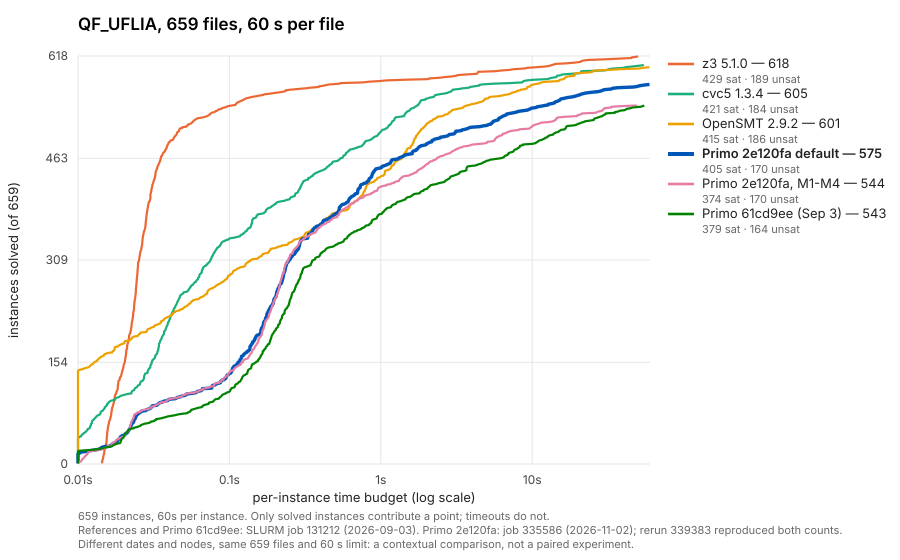

# QF_UFLIA progress against reference solvers

(qf-uflia-m124-review)=
## Four-profile follow-up at `5dec036` (2026-11-04)

The QF_LIA {ref}`slack-obligation review <integrality-slack-review>` found
that disabling M3 can help while retaining M1, M2 and M4. This follow-up asks
whether that profile, **M124**, also recovers the QF_UFLIA regressions.
All profiles use the same Release `5dec036` binary. The QF_UFLIA default
keeps all four options off; it is the baseline here.

| Profile | Solved | SAT | UNSAT | Timeout | Certora | TwoSquares | mathsat | wisas | PAR2 (s) |
|---|---:|---:|---:|---:|---:|---:|---:|---:|---:|
| Default, all off | 575 | 405 | 170 | 84 | 6 | 21 | 441 | 107 | 11,354 |
| M1+M2 | 545 | 375 | 170 | 114 | 6 | 21 | 441 | 77 | 14,873 |
| M124: M1+M2+M4 | 545 | 375 | 170 | 114 | 6 | 21 | 441 | 77 | 14,883 |
| All four options | 544 | 374 | 170 | 115 | 5 | 21 | 441 | 77 | 14,938 |


**M124 does not recover the main regression.** It loses exactly 30 files
against the default, all `wisas`, and gains none. M1+M2 and M124 solve the
same 545 files. Compared with all four options, disabling M3 recovers one
Certora SAT instance and loses none. This run does not trace the cause of
that single recovery. The default, M1+M2 and all-options solved sets match
the earlier `2e120fa` ablation exactly.

The fresh counters narrow the diagnosis further. On **every one of the 30
lost `wisas` files**, M12, M124 and all four options report zero patch
candidates, and every recorded completion call is initially fully integral.
In `wisas/xs_28_48.smt2`, the default is SAT in 0.613 s with 385 SAT
conflicts. Each M2-enabled profile times out at 60 s; each reports 17
completion calls, all initially integral, and no patch candidates. These
are partial statistics reported when the timeout is handled, not totals
for a completed search.

`patch_integer_variables` returns before candidate collection when no
integer obligation is fractional
({settingssource}`lia_patching.cpp <src/theory/arithmetic/lia_patching.cpp>`).
Thus M4's candidate rule is unused in those recorded calls: there is no
integer repair for it to improve. This supports the existing search and
theory-combination diagnosis; it does not establish a new value trajectory
for all 30 files. Among 141 files both the default and M124 solve in at least
0.5 s, M124/default runtime has median 1.009 and geometric mean 1.005.

**Decision.** Keep all four options disabled by default on QF_UFLIA. M124's
QF_LIA gain does not transfer to this corpus. The next investigation belongs
to the [search diversification lead](../leads/search-diversification.md):
understand how search leaves the difficult integral commitments while
retaining sound bound strengthening. No solver code or defaults change in
this evaluation. The earlier model-value traces remain the evidence for the
particular commitments described below.

### Why M3 off leaves the M2 change in place

M2 (primitive integer rows) normalizes Int rows to primitive integer
coefficients and marks their slacks as integer-valued. `PreparedLraTheory::append_atom` then stores the bound
rounding policy in the prepared atom. This happens independently of M3;
M1 controls whether non-strict fractional bounds are also rounded. M3
controls the extra slack variables included in integer completion's
obligations by `LiaComponentAdapter::rebuild_integer_obligations`
({settingssource}`solver_engines.cpp <src/smt/solver_engines.cpp>`).
Disabling M3 removes those extra repair obligations but leaves the stronger
prepared bounds on M2's slacks.

The earlier {ref}`wisas diagnosis <integrality-evaluation>` illustrates the
difference. A slack $t=a+b$ counts format specifiers in `xs_28_48.smt2`.
Without M2, its upper bound is $18-\delta$, and the first commitment is the
fractional value $71/4$, quickly refuted before search settles at $12$.
With M2, the bound becomes $t\le17$ and the first commitment is the integral
value $17$. Search spends most of the traced run there, learning clauses
that exclude individual counter-chain patterns. These are historical traces
of four lost files, not a fresh trace of every input or proof that the same
trajectory occurs throughout the family. M124 retains this bound change. On the lost inputs, its recorded completion
calls still arrive fully integral.

### Method, correctness and reproduction

Timing job 349196 runs all 659 files in four families at 60 s per input.
Its 132 array tasks rotate the order `off m12 m124 all` by shard index,
requesting two CPUs and 4 GiB each, with concurrency capped at 64 and a
one-hour task wall. Each task runs every profile on the same shard and node.
The profiles are: all four options off; M1+M2; M1+M2+M4; and all four on.
Every option polarity is explicit. No other solver setting is changed.

Model job 349264 depends on successful completion of the whole timing array.
It selects every successful SAT answer separately for each profile, with
132 tasks, concurrency 48, two CPUs and 12 GiB requested per task.
Replay budgets are 180 s for Primo and 300 s for Dolmen, with
`--size 8G --strict=false`. Replay times do not enter the timing table.

**Correctness is complete.** Every selected SAT answer directly passes Dolmen
0.10: 405 default, 375 M12, 375 M124 and 374 all-options models, **1,529 in
total**. All 528 per-profile coverage records are complete and bound to the
exact parent answer/provenance files and saved model-summary artifacts.
There are no invalid models, changed answers, missing rows, solver errors,
validator failures or replay timeouts. All 659 input hashes match both
archived Z3 and cvc5 corpora. There are zero contradictory decisions between
profiles or against either reference; Z3 covers all 575/545/545/544 successful
decisions, and cvc5 covers 572/542/542/541 respectively. Those references
are answer evidence from the `full-revalidation-287b743` archive, not new
timing measurements or validation of their own SAT models.

All 132 timing and 132 model tasks completed with exit `0:0`, and scheduler
records confirm that the stages did not overlap. Both stages used Xeon
E5-2690 v4 nodes 02, 03 and 04. Peak batch RSS was
2,902,584 KiB for timing and 92,620 KiB for replay; these are job-wide
maxima, not per-profile peaks. Full family counts, runtime quantiles,
per-file gains/losses, counter diagnostics and accounting are preserved in
`benchmarks/qf-uflia-m124-review-20261104.json`.

The {integralityreviewsource}`paired runner
<scripts/qualification/lia_integrality/paired_replay.sbatch>` now accepts
`PRIMO_PAIRED_ARMS`; its default remains `all m124` for the QF_LIA experiment.
The {integralityreviewsource}`analysis script
<scripts/qualification/lia_integrality/analyze.py>` accepts a baseline and
candidate, requires complete model coverage for every selected profile,
and checks all jointly solved profile pairs for contradictory decisions.
The per-file identities must match the archived Z3 corpus hashes.

```bash
# Supply PRIMO_WORKDIR, PRIMO_COMPARE_ROOT, PRIMO_COMPARE_BINARY, and
# PRIMO_COMPARE_OUT_ROOT outside tracked files.
export PRIMO_PAIRED_ARMS="off m12 m124 all"
export PRIMO_PAIRED_SHARDS=132 PRIMO_PAIRED_CHUNKS=1
export PRIMO_COMPARE_TIMEOUT=60 PRIMO_EXPECTED_GIT=5dec036
export PRIMO_CAMPAIGN_ID=uflia-m124-review-20261104-full60
PRIMO_PHASE=benchmark sbatch --array=0-131%64 --cpus-per-task=2 \
  --mem=4G --time=01:00:00 --export=ALL \
  scripts/qualification/lia_integrality/paired_replay.sbatch
PRIMO_PHASE=replay sbatch --dependency=afterok:349196 \
  --array=0-131%48 --cpus-per-task=2 --mem=12G --time=01:00:00 --export=ALL \
  scripts/qualification/lia_integrality/paired_replay.sbatch

python3 scripts/qualification/lia_integrality/analyze.py \
  --root results/uflia-integrality-review-20261104/full60 \
  --reference-root results/uflia-integrality-review-20261104/references/z3 \
  --expected-files 659 --arms off m12 m124 all --baseline off --candidate m124 \
  --out results/uflia-integrality-review-20261104/full-summary.json
```

Use the returned timing job ID in the replay dependency when reproducing.
Preflight uses `slurm_prepare_benchmark_workspace.py --check-only --no-sync`
against a clean detached `5dec036` worktree before each submission. The
binary is preserved, not rebuilt; Git abbreviation is set to seven digits
for the preflight command only, matching its version banner. The full commit
and binary digest remain recorded. Results and coverage live under
`results/uflia-integrality-review-20261104`; run-log entry
`2026-11-04-qf-uflia-m124-full-paired60-5dec036` records commands, executable
identities, resources and the final per-file comparison.

## Historical reference comparison (2026-11-03)


**Status: contextual comparison, 2026-11-03.** All series cover the same 659
QF_UFLIA files at 60 s per file, but they come from runs on different dates
and nodes, so this is not a paired experiment. A {ref}`paired rerun
<qf-uflia-paired-120s>` below reproduces the solved sets of both `2e120fa`
arms.
The QF_LIA counterpart is [QF_LIA progress](qf-lia-progress.md).



| Series | Run | Solved | Certora (76) | TwoSquares (21) | mathsat (454) | wisas (108) | PAR2 (s) |
|---|---|---|---|---|---|---|---|
| z3 5.1.0 | job 131212, 2026-09-03 | 618 | 35 | 21 | 454 | 108 | 5,490 |
| cvc5 1.3.4 | job 131212 | 605 | 25 | 21 | 454 | 105 | 7,379 |
| OpenSMT 2.9.2 | job 131212 | 601 | 18 | 21 | 454 | 108 | 8,049 |
| Primo `2e120fa`, default | job 335586, 2026-11-02 | 575 | 6 | 21 | 441 | 107 | 11,375 |
| Primo `2e120fa`, all four integrality options | job 335586 | 544 | 5 | 21 | 441 | 77 | 14,934 |
| Primo `61cd9ee` | job 131212 | 543 | 3 | 21 | 437 | 82 | 15,758 |

In the figure legend, M1-M4 means all four integrality options, milestones
M1 to M4 of the {ref}`integrality evaluation <integrality-evaluation>`.
PAR2 counts each unsolved file as 120 s. Every series reports zero wrong
answers against the declared statuses.

## What the comparison shows

- **The default has improved.** Since the first full baseline at `61cd9ee`,
  Primo solves 32 more files and loses none. The gains are 25 `wisas`, 4
  `mathsat` and 3 Certora files. PAR2 fell from 15,758 to 11,375 s. The gap
  to OpenSMT shrank from 58 to 26 files, and the gap to z3 from 75 to 43.
- **The integrality options lose many of those files.** With
  `--lia-round-integer-bounds --lia-primitive-int-rows --lia-integer-slacks
  --lia-patch-integral-moves`, Primo solves 31 fewer files than the default:
  30 `wisas` and 1 Certora. That leaves it only one file above the September
  baseline. The `wisas` loss is a search-order effect of the primitive-row
  option, traced in the {ref}`integrality evaluation
  <integrality-evaluation>`. This is why the options are off for QF_UFLIA.
  Since `5dec036` they are on by default for QF_LIA only, and the QF_UFLIA
  default is unchanged: a paired check found identical answers and search
  counters on all 539 files solved ({ref}`promotion <integrality-promotion>`).
- **The results are reproducible.** A rerun of both Primo `2e120fa` arms on
  2026-11-03 (job 339383) produced exactly the same solved sets, and so did
  the paired rerun below, cut at 60 s.
- **Remaining gap.** Certora is where Primo trails most: 6 of 76 against
  z3's 35. On `mathsat`, every reference solves all 454 files; Primo solves
  441.

(qf-uflia-paired-120s)=
## Paired rerun at 120 s (2026-11-03)

The run-log entry `2026-11-03-paired-120s-rerun` records a rerun of
`5efbd02`, the `2e120fa` default and `2e120fa` with all four integrality
options, at 120 s per file. `5efbd02` is the October binary compared on the
{ref}`QF_LIA page <qf-lia-paired-120s>`. Its October run on QF_UFLIA (job
167599, not in the table above) solved 574 files at 60 s, one fewer than
here.
All three configurations ran in the same array
task, on the same node, with two CPUs per task (job 345182, 40 tasks, 30 of
them on node 03). The design is described on the {ref}`QF_LIA page
<qf-lia-paired-120s>`.

| Configuration | Solved, 60 s | PAR2, 60 s | Solved, 120 s | PAR2, 120 s |
|---|---|---|---|---|
| Primo `5efbd02` | 575 | 11,343 | 577 | 21,118 |
| Primo `2e120fa`, default | 575 | 11,347 | 577 | 21,122 |
| Primo `2e120fa`, all four integrality options | 544 | 14,938 | 548 | 28,150 |

PAR2 counts each unsolved file as twice the limit. There are no wrong
answers and no disagreements between configurations; every unsolved run is a
timeout.

- **`5efbd02` and the current default solve the same files** at both limits.
  On the 194 files both solve in at least 0.5 s, the default takes a median
  1.002 times the time of `5efbd02`.
- **The options lose 31 files at 60 s and 29 at 120 s**: the same 30
  `wisas` and 1 Certora file at 60 s. At 120 s, 2 of those `wisas` files
  solve in 74 and 84 s, and the options also solve the two Certora files the
  default gains, in 104 and 111 s. On the 145 files both solve in at least
  0.5 s, the options take a median 1.045 times the default's time.
- **Doubling the limit adds little.** The default and `5efbd02` each gain
  two Certora files, solved in 74 to 101 s.

## Reproduction

The cactus plot is drawn by {source}`plot_cactus.py <scripts/plot_cactus.py>`:

```bash
python3 scripts/plot_cactus.py --timeout 60 --sort-by-solved \
  --title "QF_UFLIA, 659 files, 60 s per file" \
  --highlight-series "Primo 2e120fa default" \
  --series "z3 5.1.0=<131212>/z3" --series "cvc5 1.3.4=<131212>/cvc5" \
  --series "OpenSMT 2.9.2=<131212>/opensmt" \
  --series "Primo 61cd9ee (Sep 3)=<131212>/primo" \
  --series "Primo 2e120fa default=<ab>/QF_UFLIA/off" \
  --series "Primo 2e120fa, M1-M4=<ab>/QF_UFLIA/all" \
  --note "References and Primo 61cd9ee: SLURM job 131212 (2026-09-03). Primo 2e120fa: job 335586 (2026-11-02); rerun 339383 reproduced both counts." \
  --note "Different dates and nodes, same 659 files and 60 s limit: a contextual comparison, not a paired experiment." \
  --out docs/_static/qf-uflia-cactus.svg
```

Here `<131212>` is `results/qf-uflia-full-131212` in the cluster workspace
`primo-qflia-fuzz-gate`, and `<ab>` is `results/m5-ab-2e120fa` in
`primo-lia-integrality`. The run-log entries
`2026-09-03-qf-uflia-full-smtlib-61cd9ee` and
`2026-11-02-lia-integrality-ab-2e120fa` hold the provenance. The paired
rerun used the QF_LIA command on the {ref}`QF_LIA page <qf-lia-paired-120s>`
with `--array=0-39%12 --time=04:00:00`, `PRIMO_COMPARE_ROOT=tmp/QF_UFLIA`,
`PRIMO_PAIRED_SHARDS=40` and the output directory
`results/paired-120s-20261103/QF_UFLIA`.
