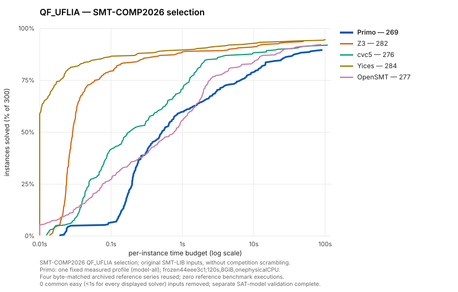
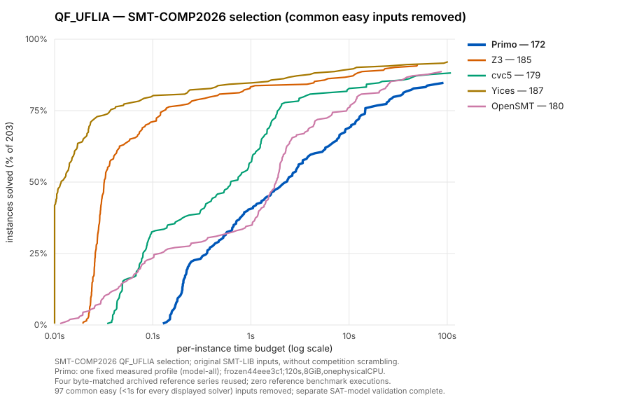

# QF_UFLIA on the SMT-COMP 2026 selection

**Status: complete; all successful native SAT timing rows are direct-Dolmen validated.**

## Qualified results

All 1,500 native timing rows are complete. Every one of the 998 successful native SAT rows passes separate direct Dolmen validation. There are no contradictory answers, invalid models or unexplained native errors.

| Profile | Solved / 300 | SAT | UNSAT | PAR2 sum (s) |
| --- | ---: | ---: | ---: | ---: |
| Current default (off) | 259 | 203 | 56 | 10,610.27 |
| Legacy / all | 261 | 195 | 66 | 10,981.39 |
| Model-unit / all | 269 | 202 | 67 | 8,611.16 |
| Legacy / fixed | 266 | 199 | 67 | 9,112.20 |
| Model-unit / fixed | 266 | 199 | 67 | 9,400.98 |
| Z3 (archived) | 282 | 213 | 69 | 4,592.95 |
| cvc5 (archived) | 276 | 208 | 68 | 6,352.80 |
| Yices (archived) | 284 | 212 | 72 | 4,162.68 |
| OpenSMT (archived) | 277 | 207 | 70 | 6,489.46 |

The plotted Primo profile is `model-all`, selected once across the entire 300-input cohort. It solves 269 cases, versus 259 for the default control and 276 for archived cvc5. Profile selection is descriptive of this measured cohort; it does not promote a solver default.

| Comparison | Gains | Losses | Common pairs ≥50 ms | Geometric ratio |
| --- | ---: | ---: | ---: | ---: |
| Model-unit/all vs legacy/all | 9 | 1 | 245 | 0.475 |
| Model-unit/fixed vs legacy/fixed | 2 | 2 | 249 | 0.972 |
| Model-unit/all vs defaults | 13 | 3 | 241 | 1.237 |

Ratios divide the first profile’s runtime by the second’s on common successes
taking at least 50 ms in either arm; below one means faster. Each profile/input
has one observation, so small timing differences need repetitions before acceptance.

| Family | Inputs | Default | Model-unit / all | Model-unit / fixed | cvc5 |
| --- | ---: | ---: | ---: | ---: | ---: |
| Certora | 37 | 7 | 8 | 5 | 14 |
| mathsat | 202 | 191 | 202 | 202 | 202 |
| wisas | 61 | 61 | 59 | 59 | 60 |

Counts in the family table are solved inputs. The [summary](../../benchmarks/uflia-smtcomp2026-20261111/summary.json) retains all nine series, status/resource counts, paired input timings, gains/losses and artifact hashes. The [qualification record](../../benchmarks/uflia-smtcomp2026-20261111/qualification.json) records source/binary identities, commands, resource limits and jobs. Raw timing rows and counters are retained in the [portable timing archive](../../benchmarks/uflia-smtcomp2026-20261111/timings.jsonl.gz).

The gain over defaults is concentrated in MathSAT (202 versus 191 solves),
with one additional Certora solve and two fewer Wisas solves. Against legacy/all,
model-unit/all gains a net seven Wisas solves (eight gains, one loss) and adds
one Certora solve; both
solve all 202 MathSAT inputs. The remaining gap to cvc5 is concentrated in
Certora: eight of 37 solves versus cvc5's 14. On Wisas, the counts are 59 versus
60, and both solve all MathSAT inputs.

Common-success timing has a separate tradeoff: model-unit/all's geometric ratio
against defaults is 1.237, even while its solved count and PAR2 improve. The
fixed policy exchanges two gains for two losses against legacy/fixed and keeps
the same total. Defaults remain unchanged. These results qualify the requested
300-input selection replay; the other 359 corpus inputs were not rerun here.

## Cactus plots

The filtered view removes 97 inputs every displayed solver solves in under one second, leaving 203 inputs. It uses the same selected Primo configuration and axis ranges.

## Selection and comparison contract

This rerun uses the 300 unique, non-incremental QF_UFLIA inputs named in the
[official SMT-COMP 2026 SingleQuery results dataset](https://raw.githubusercontent.com/SMT-COMP/smt-comp.github.io/master/data/results-sq-2026.json.gz).
The downloaded gzip has SHA256
`7abe5cadf800cc84db00506f85176378f714cdaa8c02a0e491059835f5039c58`.
The [manifest](../../benchmarks/uflia-smtcomp2026-20261111/selection.json)
records input names, hashes and sizes: 37 Certora, 202 MathSAT and 61 Wisas
instances. All 300 occur in the earlier 659-input QF_UFLIA corpus.

Primo runs on the original SMT-LIB input contents, without competition
scrambling. This replays the official selection; its runtimes are separate
from official competition-machine results. The official dataset determines
membership only. The four reference series come from our prior controlled,
enforced-memory archive, restricted to byte-identical selected inputs and
censored at 120 seconds. The [reused rows](../../benchmarks/uflia-smtcomp2026-20261111/references.csv)
come from the [uniform120 timing archive](../../benchmarks/uniform120-20261109/report/timing.csv.gz).
No reference solver is rerun. Original successful
reference answers beyond 120 seconds remain available for contradiction checks.

The current production implementation is unchanged between the qualified
`44eee3c1` source/test snapshot and `80f8dc88`. This campaign reuses the frozen
Release binary from that qualification, SHA256
`1f7db885abdb8e8ee01ac7daf0d2113cb892416b0f0c65d8e75a3c67717b78c5`.
It was built through the preparation helper on SLURM; each new submission
uses a fresh helper preflight. Reusing this identified binary preserves the
[preceding correctness gates](uflia-model-unit-20261111.md), including the
exact model-unit `all` and `fixed` option sets and real-seed mutations.

## Profiles, limits and acceptance

Every input runs once under each of five fixed profiles, rotating their order
by input index. All arms use the same binary, default arithmetic settings,
`--quiet --stats` and these options:

| Arm | Discovery | `--qf-uflia-tableau-equalities` |
| --- | --- | --- |
| Current default control | legacy | off |
| Legacy / all | legacy | all |
| Model-unit / all | model-unit | all |
| Legacy / fixed | legacy | fixed |
| Model-unit / fixed | model-unit | fixed |

Discovery is selected with `--qf-uflia-lia-equality-producer`. The manifest
contains the exact ordered argument lists. This is a full selection comparison,
with one observation per profile/input; it is not another three-repeat diagnostic
experiment and is not a default promotion. The earlier 12-case experiment
retains its separate repetitions and regression investigations.

All solver work runs on SLURM. Each case task requests one physical CPU,
8 GiB and 25 minutes; concurrency is capped at 32. Native solves have a
120-second wall limit and an 8 GiB address-space cap. Durable per-row JSONL
retains answers, exit status, runtimes and counters. Only clean, decisive
`sat`/`unsat` rows within 120 seconds count as solved; `unknown`, timeout,
unsupported and failed exits do not. PAR2 charges 240 seconds to an unsolved row.
Contradictions, unsupported inputs and unexplained errors stop acceptance.
Normal memory exhaustion remains an unsolved resource outcome. The existing
exact-input allocation/cleanup diagnostic handles the known masked abort
signature in a separate phase, without changing its raw timing row.

A global timing barrier precedes resource diagnostics, followed by a global
barrier before model replay. Every successful native SAT timing row is selected
for independent direct Dolmen validation, under its exact timed arguments plus
`--check-model`. Replay allows 180 seconds for Primo and 60 seconds for Dolmen,
with Dolmen's 1 GiB size budget and `--strict=false`. No model-validation or
diagnostic time enters the speed results. Missing or incomplete validation
prevents a correctness-qualified result; reference comparison and model checks
do not certify UNSAT answers as proofs.

The cactus plots retain the earlier uniform 0.01–120 second log
axis, 0–100% solved axis and solver colours. Exactly one fixed Primo profile
is chosen for the entire selection by most solves, then lower PAR2, then
profile name, and labelled **Primo**. The same profile serves the full and
filtered views. Filtering removes only inputs every displayed solver solves
in under one second. Detailed tables retain all five arms, so the plotted
profile choice does not hide the comparison or create a per-input portfolio.

The {download}`case worker <../../scripts/qualification/uflia_smtcomp2026/run.py>`
owns timing, resource classification and model replay; its
{download}`SLURM wrapper <../../scripts/qualification/uflia_smtcomp2026/run.sbatch>`
sets the allocation. The [retained dependencies](../../benchmarks/uflia-smtcomp2026-20261111/dependencies.json)
record the global phase barriers. The
{download}`auditor and plot generator <../../scripts/qualification/uflia_smtcomp2026/report.py>`
checks complete coverage before selecting a Primo profile or drawing plots.
