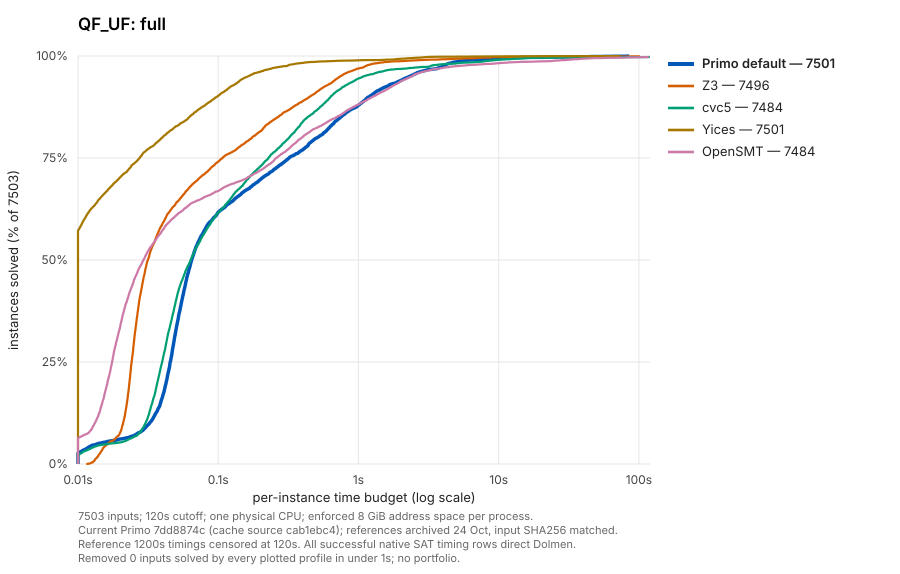
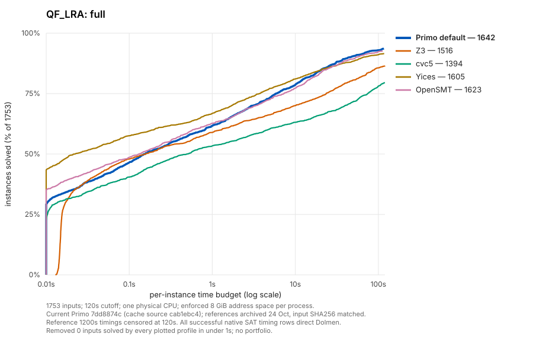
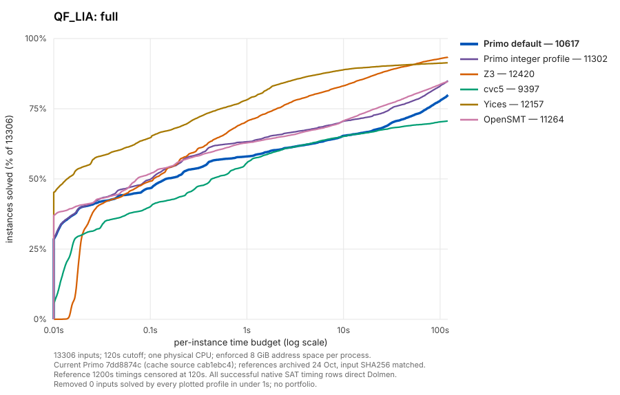
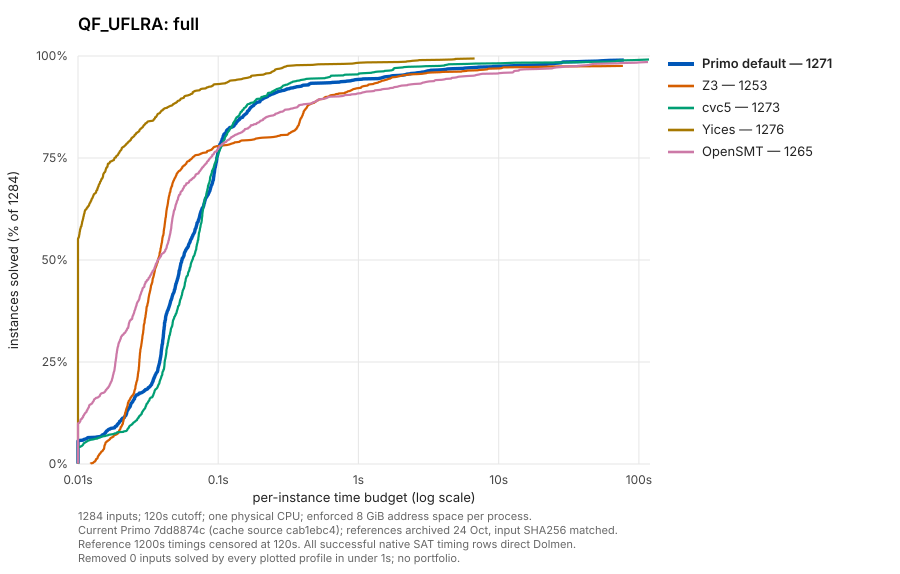
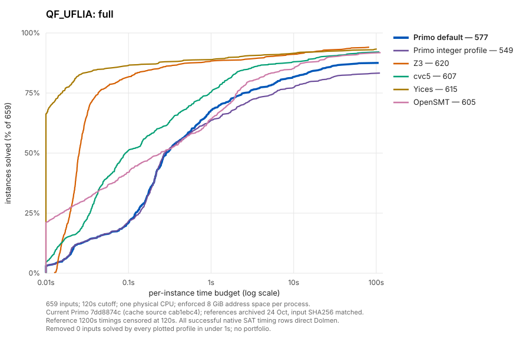

(uniform120-evaluation)=
# Uniform 120-second theory comparisons

**Status: complete and correctness-qualified.** The 120-second campaign finished
38,470 native profile/input timing rows. All 20,351 successful native SAT timing
rows have separate direct Dolmen validation. The four archived reference solvers
were reused without any reference corpus rerun. Normal memory-outs remain
unsolved budget outcomes, including the initially misclassified cleanup abort.
The five quantifier-free divisions contain 24,505 inputs:

| Logic | Full corpus |
| --- | ---: |
| QF_UF | 7,503 |
| QF_LRA | 1,753 |
| QF_LIA | 13,306 |
| QF_UFLRA | 1,284 |
| QF_UFLIA | 659 |

The [earlier 200-input LIA chart](arithmetic-overhead-20261109.md#current-version-cactus-plots) was a development selection, whose ranking
need not match the full division. In the earlier full 13,306-input comparison,
Primo M124 solved 9,865 and archived cvc5 solved 9,239 at 60 seconds; those are
[historical results](qf-lia-progress.md) for their stated sources and profiles. Raising the wall
limit does not itself remove easy cases or guarantee a ranking reversal.

## Qualified results

All series use a 120-second cutoff, one physical CPU and an enforced 8 GiB
address-space limit. These are full-corpus solved counts; each optional integer
profile is fixed across its entire logic, and curves remain separate.

| Logic | Inputs | Primo default | Integer profile | Z3 | cvc5 | Yices | OpenSMT |
| --- | ---: | ---: | ---: | ---: | ---: | ---: | ---: |
| QF_UF | 7,503 | 7,501 | — | 7,496 | 7,484 | 7,501 | 7,484 |
| QF_LRA | 1,753 | 1,642 | — | 1,516 | 1,394 | 1,605 | 1,623 |
| QF_LIA | 13,306 | 10,617 | 11,302 | 12,420 | 9,397 | 12,157 | 11,264 |
| QF_UFLRA | 1,284 | 1,271 | — | 1,253 | 1,273 | 1,276 | 1,265 |
| QF_UFLIA | 659 | 577 | 549 | 620 | 607 | 615 | 605 |

Primo is ahead of cvc5 on full QF_LIA: 10,617 versus 9,397 with defaults,
and 11,302 with the declared integer profile. On QF_LRA, Primo solves 1,642,
ahead of OpenSMT’s 1,623 and the other archived references. QF_UF ties Yices
at 7,501 solves, although Yices has lower PAR2. QF_UFLRA remains close behind
Yices/cvc5, and QF_UFLIA remains behind the references.

The integer profile gains 685 QF_LIA solves over defaults: 734 gains and 49
losses on matched inputs. On QF_UFLIA it loses 28 solves with no gains. This
does not support promotion across logics or a per-input portfolio.

### Normalized PAR2

Each unsolved input costs 240 seconds. The table divides the PAR2 sum by the
logic’s input count; lower is better. Raw sums, SAT/UNSAT, timeout, unknown,
resource and error counts, plus family summaries remain in the exported data.

| Logic | Primo default | Integer profile | Z3 | cvc5 | Yices | OpenSMT |
| --- | ---: | ---: | ---: | ---: | ---: | ---: |
| QF_UF | 0.649 | — | 0.489 | 1.051 | 0.141 | 1.485 |
| QF_LRA | 21.130 | — | 40.316 | 58.247 | 24.871 | 23.487 |
| QF_LIA | 57.043 | 44.594 | 20.392 | 73.131 | 22.031 | 43.451 |
| QF_UFLRA | 3.092 | — | 6.189 | 2.794 | 1.556 | 4.748 |
| QF_UFLIA | 32.022 | 42.342 | 15.285 | 20.745 | 16.929 | 22.200 |

### Does the larger timeout explain the LIA ranking?

In this same qualified dataset, Primo is already ahead of cvc5 when the
measurements are censored at 60 seconds. Extending the view to 120 seconds
adds 858 default solves, 849 integer-profile solves and 175 cvc5 solves. These
are views of the recorded runs, not additional solver executions.

| QF_LIA series | At 60 seconds | At 120 seconds |
| --- | ---: | ---: |
| Primo default | 9,759 | 10,617 |
| Primo integer profile | 10,453 | 11,302 |
| cvc5 | 9,222 | 9,397 |

The earlier 200-input development selection does not determine full-corpus
ranking. Historical full-corpus charts also used different profiles, measurement
dates and allocations; the November 4 report did not establish an enforced
native memory cap or archived cvc5 input hashes. The present comparison uses
the October 24 enforced-memory reference archive and matches every input hash.
It does not predict Primo’s behavior beyond 120 seconds.

### Matched runtimes against cvc5

Ratios are geometric means of Primo/cvc5 time on inputs both solve successfully
within the cutoff; below one means Primo is faster. The filtered cohort removes
only inputs every plotted profile solves in under one second. These are
descriptive matched-input ratios from different measurement dates, not a
controlled A/B speedup experiment. They are separate from solved counts and PAR2.

| Logic/profile | Common solved, full | Full ratio | Common solved, filtered | Filtered ratio |
| --- | ---: | ---: | ---: | ---: |
| QF_UF, Primo default | 7,483 | 1.202 | 1,070 | 1.721 |
| QF_LRA, Primo default | 1,388 | 0.392 | 462 | 0.140 |
| QF_LIA, Primo default | 8,611 | 0.448 | 1,778 | 0.209 |
| QF_LIA, Primo integer profile | 9,161 | 0.387 | 2,328 | 0.143 |
| QF_UFLRA, Primo default | 1,269 | 0.969 | 144 | 1.572 |
| QF_UFLIA, Primo default | 576 | 2.575 | 283 | 3.143 |
| QF_UFLIA, Primo integer profile | 548 | 2.800 | 255 | 3.720 |

## Uniform cactus plots

[Open the full gallery](../_static/uniform120-20261109/index.html). Every panel
uses the same 0.01–120 second log axis and 0–100% solved axis. Higher curves
mean more solves within that per-input budget. Full views appear below;
each filtered view uses the same colours and scales with its stated denominator.

### QF_UF

[Filtered view](../_static/uniform120-20261109/qf_uf-nontrivial.svg): 1,090 inputs;
6,413 common easy inputs removed.

### QF_LRA

[Filtered view](../_static/uniform120-20261109/qf_lra-nontrivial.svg): 827 inputs;
926 common easy inputs removed.

### QF_LIA

[Filtered view](../_static/uniform120-20261109/qf_lia-nontrivial.svg): 6,473 inputs;
6,833 common easy inputs removed.

### QF_UFLRA

[Filtered view](../_static/uniform120-20261109/qf_uflra-nontrivial.svg): 159 inputs;
1,125 common easy inputs removed.

### QF_UFLIA

[Filtered view](../_static/uniform120-20261109/qf_uflia-nontrivial.svg): 366 inputs;
293 common easy inputs removed.

## Completed correctness and resource accounting

All 20,351 selected successful native SAT timing rows passed Dolmen directly,
with unchanged input/binary identities and matching profile arguments. Timing
and validation did not overlap. There were no wrong answers, contradictory
concrete decisions, invalid models or unclassified native execution errors.
This validates SAT models and reference agreement; it does not supply independent
UNSAT proofs.

| Logic/profile | SAT timing rows | Direct Dolmen passes |
| --- | ---: | ---: |
| QF_UF, Primo default | 3,142 | 3,142 |
| QF_LRA, Primo default | 983 | 983 |
| QF_LIA, Primo default | 7,024 | 7,024 |
| QF_LIA, Primo integer profile | 7,656 | 7,656 |
| QF_UFLRA, Primo default | 760 | 760 |
| QF_UFLIA, Primo default | 407 | 407 |
| QF_UFLIA, Primo integer profile | 379 | 379 |

The native runs contain 782 memory-out profile/input rows: 409 independently
replayed allocation/cleanup aborts and 373 explicit allocation failures. All
retain their raw error exits and remain unsolved with the full PAR2 penalty.
These include repeated inputs under different fixed profiles, not 782 distinct
corpus files. The cleanup defect remains recorded; it is not a prerequisite for
counting confirmed budget exhaustion normally. Clean unknowns occur only in
QF_LIA: 498 with defaults and 328 with the integer profile.

Archived reference errors also remain unsolved and separately reported. For
example, the censored cvc5 LIA view contains 27 explicit memory-outs and 34 other
error rows; OpenSMT has 21 LIA error rows. No reference failure was rerun or
silently turned into a successful result.

The source remains the accepted interval-cache implementation; the losing CITE
comparison change remains reverted. This campaign changes benchmark accounting
and reporting, with no new arithmetic options, flattening thresholds, search
heuristics or default promotion.

### Downloadable evidence

- {download}`Qualified summary and family metrics <../../benchmarks/uniform120-20261109/report/summary.json>`
- {download}`Paired raw timing table (gzip) <../../benchmarks/uniform120-20261109/report/timing.csv.gz>`
- {download}`Curve arrays and denominators <../../benchmarks/uniform120-20261109/report/plot-data.json>`
- {download}`Matched-input comparisons and budget counts <../../benchmarks/uniform120-20261109/report/comparisons.json>`
- {download}`Export provenance and checksums <../../benchmarks/uniform120-20261109/report/provenance.json>`
- {download}`Generated-gate commands, seeds and coverage <../../benchmarks/uniform120-20261109/gate-provenance.json>`

The {download}`analysis owner <../../scripts/qualification/uniform120/analyze.py>`
rechecks exported identities, full scores and common-easy cohort membership before
computing descriptive comparisons. The run ledger records all SLURM stages,
recovery, resource-classification evidence and the independent documentation
review. Raw binaries, inputs, original logs and model responses remain in the
recorded private execution archive. Quantified UF is excluded.

## Frozen inputs, profiles and reused references

Only Primo is timed anew, from source `7dd8874c`, whose production source and
C++ tests match the accepted interval-cache implementation `cab1ebc4`. CITE fast
paths remain rejected. Defaults run in every division. LIA and UFLIA also run
one fixed optional integer profile: integer-bound rounding, primitive integer
rows, no integer-slack obligations, integral patch moves and uniform cubes.
Uniform cubes apply to pure QF_LIA; the switch is ignored by QF_UFLIA. Profiles
remain separate curves; no per-input portfolio or promotion of defaults occurs.

The four reference candidates are archived Z3, cvc5, Yices and OpenSMT runs from
the October 24 enforced-memory campaign. Admission and timing records are read
from that campaign. Their original 1,200-second measurements are viewed at a
120-second cutoff. No reference corpus benchmark is rerun. This reuse requires
matching input SHA256 values, unchanged parent identities, complete unique row
coverage and the original solver arguments/binary identities. The parent plan
hash is `dd01e5c49cdbb9a75b4e2c819d15cc4f15514c0f2506506d6030127946db48ca`.

The {download}`campaign owner <../../scripts/qualification/uniform120/campaign.py>`
imports read-only reference rows into derived views, retaining original status
and duration. Source CSV/provenance hashes and derived CSV hashes form a reuse
certificate. A certificate digest is bound into the new plan before timing.
Reference rows cannot enter the worker's execution task list. Historical error,
unsupported and resource-limit rows remain unsolved and are reported separately.
Different measurement dates remain a limitation even when inputs and limits match.

## Execution and correctness contract

Both archived references and new native timings use one physical CPU on the
same Xeon E5-2690 v4 generation and an enforced **8 GiB per-process address-space
limit**, with an 8 GiB SLURM request. The process limit is checked explicitly;
a memory reservation alone is insufficient. Every input receives 120 seconds.
A successful solve requires SAT/UNSAT, exit zero, no timeout and a measured
runtime within the limit. Unknown and timed-out post-answer exits are unsolved.

Builds use the preparation helper with `--build-via-slurm`; its preflight runs
immediately before each submission. Fresh generated gates check 1,000 cases
per theory/profile with direct SAT-model checks. Their Z3 calls are differential
correctness checks on generated inputs, distinct from corpus reference timings.
Source-matched real-seed mutation qualification from the accepted cache stage
is retained as prior evidence; this campaign makes no new source-behavior change.
Wrong answers, contradictory concrete answers and unexplained native execution
failures stop the campaign. Explicit or independently confirmed address-space
exhaustion is a reported unsolved resource outcome.

All timing arrays must finish and pass the global audit before model replays
start. Every successful native SAT timing row then receives separate direct
Dolmen validation, with a 180-second solver replay and 60-second validator
budget. Missing, invalid or incomplete coverage blocks qualification. Model
checking time never enters runtime curves. Worker journals retain completed
rows during a task; private submission state records owned arrays for cancellation.

## Uniform presentation

The {download}`report owner <../../scripts/qualification/uniform120/report.py>`
uses fixed solver colours and ordering across all five divisions. Blue is
Primo defaults; purple is the declared optional integer profile. Every panel
has the same logarithmic time axis, 0.01–120 seconds, and a 0–100% solved axis;
legends retain absolute counts. Higher curves mean more inputs solved within
the per-input time budget, rather than cumulative elapsed time.

Each division has two views. The full view retains every input. The nontrivial
view removes only inputs every plotted profile solves in under one second.
Its cohort and denominator are explicitly reported, and its counts/PAR2 are
kept separate from full-corpus metrics. The filter is computed after measurement
and never changes the scored full corpus. Quantified UF is outside this report.

Exact options and phase budgets are in the
{download}`configuration <../../scripts/qualification/uniform120/config.json>`;
{download}`worker batch <../../scripts/qualification/uniform120/run.sbatch>` and
{download}`audit batch <../../scripts/qualification/uniform120/report.sbatch>`
run in SLURM. SSH routes and corpus roots remain private. The run-log entry
`2026-11-09-uniform120` records preparation failures, jobs, throughput estimates,
phase outcomes and acceptance status as the campaign progresses.

## Initial stopped corpus attempt

The frozen native binary passed 6,969 of 7,000 generated profile/input checks;
31 were inconclusive timeouts. All 5,041 primary SAT cases received direct
Dolmen acceptance. The full reference import then certified all 20 archived
logic/solver series against freshly hashed inputs. No reference corpus solver
was executed.

The new timing campaign stopped on QF_LIA input
`nec-smt/large/getoption_user/prp-42-49.smt2`, using Primo defaults. After
58.558420 seconds the process exited with SIGABRT (`-6`), reporting an invalid
CaDiCaL API state while disconnecting the external propagator. Its input SHA256
is `eae1898b95df0fec3544ab4365e6e7dfc76c0057ffc1c5071cdeadf2db3a60ab`.
The enforced address-space limit was 8 GiB. This row is an execution error,
not a successful solve or a measured timeout.

The owner guard cancelled the remaining timing and dependent model arrays.
Forty-two timing shards had completed; the global timing and final audits failed
because corpus coverage was incomplete. No corpus SAT-model replay completed,
and the partial rows do not establish solved counts, PAR2 or solver rankings.
Increasing the timeout cannot repair an abort already reached below 120 seconds.

The [older allocation/cleanup diagnoses](long-limits.md) show a similar diagnostic
for other exact input/binary combinations. They do not classify this new row.
The new bounded debugger replay confirms allocation failure during binary-clause
vector growth in SAT preprocessing, followed by an abort in external-propagator
cleanup while the exception unwinds. This identifies the mechanism for this
exact input/profile/binary combination in the replay; it does not classify other
crashes by their message. The library's
exception type was not printable without debug information. The inferior's
8 GiB address-space limit was verified directly; the diagnostic allocation
reserved 10 GiB for the solver plus debugger and supplies no speed measurement.
The {download}`failure record <../../benchmarks/uniform120-20261109/blocker.json>`
contains identities, stack summaries and raw-log digests. The newly written
{download}`debugger commands <../../scripts/qualification/uniform120/crash.gdb>`
and {download}`batch script <../../scripts/qualification/uniform120/crash.sbatch>`
preserve the replay procedure. The initial guard was too strict for this triaged resource failure. The cleanup
defect remains recorded, while recovery treats a confirmed memory-out as an
unsolved budget outcome. The saved references remain reusable; they need no rerun.

## Memory-out classification and recovery

The {download}`resource classifier <../../scripts/qualification/uniform120/resource_triage.py>`
recognises only the specific SIGABRT/disconnection diagnostic as a candidate for
allocation triage. A matching message alone is insufficient to call a row a
memory-out. During a timing shard that candidate may remain pending; all other
unexplained errors, wrong answers and concrete disagreements remain blocking.

After the shard's timing harness has exited, each candidate is replayed under
GDB with the same frozen binary, ordered arguments, input content hash and hard
8 GiB address-space limit. No diagnostic solver runs alongside a timed solver
on that task's allocated CPU. The replay has a separate 240-second budget.
The {download}`debugger commands <../../scripts/qualification/uniform120/resource.gdb>`
record an allocation throw through `operator new`, then continue and record the
SIGABRT cleanup stack. Missing or different evidence leaves the crash unexplained
and stops the campaign. The exception type itself need not be printable.

Each successful diagnosis owns a `resource-triage/<identity>/proof.json` beside
the original timing shard, with raw diagnostic logs, their hashes and replay
identity. Identity includes the original row digest, input/binary hashes,
profile/options and memory limit. Reports verify these identities and logs
before annotating an in-memory copy of a row. The original CSV status, exit code,
answer and measured seconds are never rewritten. A confirmed memory-out remains
unsolved and receives the full PAR2 penalty; summaries retain both the raw error
exit count and the confirmed allocation/cleanup count. Diagnostic duration does
not enter performance metrics or SAT-model coverage.

The {download}`recovery owner <../../scripts/qualification/uniform120/recover.py>`
certifies complete timing shards against their original plan/provenance and
archives interrupted directories before rerunning their tasks. The immutable
plan, input inventories, saved references and native binary remain unchanged.
New plans and recovery certificates bind the worker/classifier/debugger/report hashes;
reused shards retain their original driver and CSV digests. All successful native
SAT timing rows still require separate direct Dolmen validation after the global
timing audit. This changes benchmark classification and orchestration only;
Primo's C++ source and solver decisions are unchanged.

## Portable report data

The {download}`export owner <../../scripts/qualification/uniform120/export.py>`
requires a complete timing/model audit with matching plan/reference identities.
It matches the recovery certificate to the audit, verifies inventory hashes
against the plan, and checks each native CSV against its model-coverage parent
digest and each reference CSV against the reuse certificate. It verifies
resource proofs; full/filtered metrics must match the qualified audit. The gallery is
regenerated from these verified rows; existing gallery files are ignored.

The output contains the full and filtered SVG gallery, `summary.json`,
`plot-data.json`, `provenance.json` and a deterministic `timing.csv.gz`. The
compressed table preserves input/profile pairing, input hashes, raw statuses,
exit codes and original reference fields, plus a separate resource classification
and proof digest. Plot data contains each view's denominator, sorted successful
runtimes and the fixed colour mapping. Private execution roots, log paths and
diagnostics are omitted from the table; tool versions use their first line and
a digest of the full recorded text. Exported files are result artifacts, not new
solver measurements. An existing destination is refused to preserve attempts.
